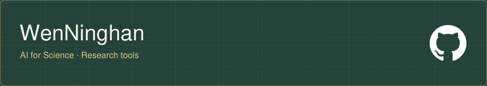

华中科技大学人工智能方向学生，关注化学预测、复杂系统与科研工具。

### 做过的一些项目

- **[DECAT](https://github.com/WenNinghan/DECAT)** · 参与臭氧与污染物反应动力学预测研究，提供模型复现与交互演示。
- **[识页 Shiye](https://github.com/WenNinghan/shiye)** · 本地 OCR、公式校对与 Word / Markdown / PDF 导出工具；提供 Windows 预发布版。
- **[Toccata-Windows](https://github.com/WenNinghan/Toccata-Windows)** · 基于 [KMnO4-zx 的 macOS 原作](https://github.com/KMnO4-zx/Toccata)，进行非官方 Windows 移植与适配。

参与建设 [AIAADC](https://github.com/AIAADC) 的课程资料与学习资源。

---

[个人网站 · WinnieHoney](https://wenninghan-personal.mccleerpavis667.chatgpt.site)
