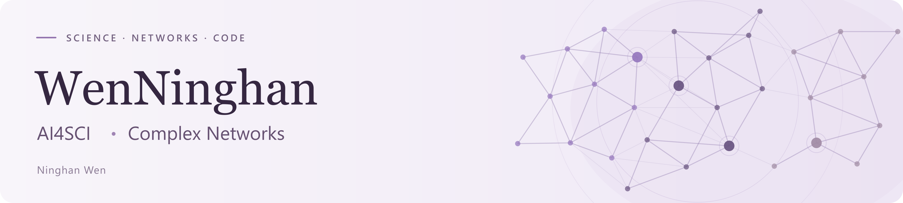

### About me

华中科技大学人工智能与自动化学院本科生，关注 **AI4SCI** 与 **复杂网络（Complex Networks）**。

目前围绕环境反应动力学建模与复杂系统优化开展研究，也做一些服务学习和科研的小工具。

### Selected work

- **[DECAT](https://github.com/WenNinghan/DECAT)** · 化学感知双专家模型，用于臭氧–污染物反应速率预测；提供代码、数据与在线预测。
- **[识页 Shiye](https://github.com/WenNinghan/shiye)** · 本地 OCR、公式校对与可编辑文档导出；Windows 预发布版。
- **[Toccata-Windows](https://github.com/WenNinghan/Toccata-Windows)** · [KMnO4-zx 的 macOS 原作](https://github.com/KMnO4-zx/Toccata)的非官方 Windows 移植与适配。

参与建设 [AIAADC](https://github.com/AIAADC) 的课程资料与学习资源。

---

[个人网站 · WinnieHoney](https://winniehoney.win/)
