

  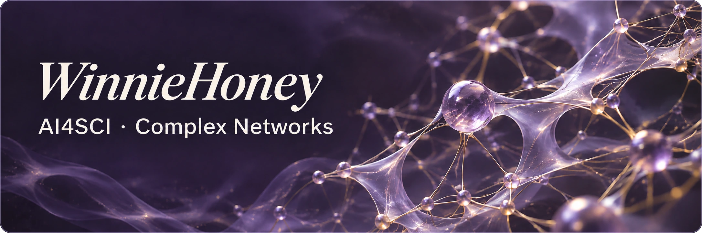

  <strong>华中科技大学 · 人工智能与自动化学院本科生 (HUST AIA)</strong> 
  关注 AI4SCI 与复杂网络，围绕环境反应动力学建模、复杂系统韧性与控制、多目标优化及可溯源 Agent 工具开展研究。

  <a href="https://winniehoney.win/"><picture><source media="(prefers-color-scheme: dark)" srcset="./assets/profile/pills/site-dark.svg"></picture></a>&nbsp;
  <a href="https://github.com/WenNinghan/DECAT"><picture><source media="(prefers-color-scheme: dark)" srcset="./assets/profile/pills/decat-dark.svg"></picture></a>&nbsp;
  <a href="https://github.com/WenNinghan?tab=repositories"><picture><source media="(prefers-color-scheme: dark)" srcset="./assets/profile/pills/repos-dark.svg"></picture></a>&nbsp;
  <a href="https://github.com/AIAADC"><picture><source media="(prefers-color-scheme: dark)" srcset="./assets/profile/pills/aiaadc-dark.svg"></picture></a>

### 🔬 Research & Core Algorithms · 代表性科研与底层算法

  <a href="https://github.com/WenNinghan/DECAT"><picture><source media="(prefers-color-scheme: dark)" srcset="./assets/profile/cards/decat-dark.svg">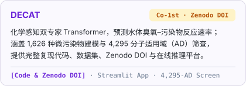</picture></a>&nbsp;
  <a href="https://github.com/WenNinghan/NetControl-Pinning-Lab"><picture><source media="(prefers-color-scheme: dark)" srcset="./assets/profile/cards/netcontrol-dark.svg">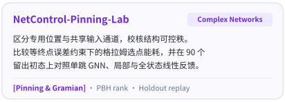</picture></a>

  <a href="https://github.com/WenNinghan/HEOA"><picture><source media="(prefers-color-scheme: dark)" srcset="./assets/profile/cards/heoa-dark.svg">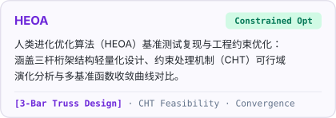</picture></a>&nbsp;
  <a href="https://github.com/WenNinghan/Deep-Learning"><picture><source media="(prefers-color-scheme: dark)" srcset="./assets/profile/cards/deeplearning-dark.svg">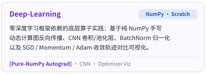</picture></a>

> 📖 延伸理论学习参考：<a href="https://github.com/WenNinghan/ComplexNetworks"><b>ComplexNetworks</b></a>（复杂网络理论、算法与高阶网络教学代码库，Fork 自 <a href="https://github.com/XL-lab-bigdata/ComplexNetworks">XL-lab-bigdata/ComplexNetworks</a>）。

### 🛠️ Verifiable Agents & Local-First Tooling · 科研与效率工具链

  <a href="https://github.com/WenNinghan/OmniHarness"><picture><source media="(prefers-color-scheme: dark)" srcset="./assets/profile/cards/omniharness-dark.svg">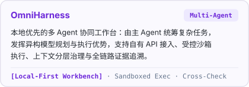</picture></a>&nbsp;
  <a href="https://github.com/WenNinghan/CrossVerify-Bench"><picture><source media="(prefers-color-scheme: dark)" srcset="./assets/profile/cards/crossverify-dark.svg">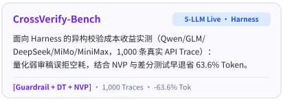</picture></a>

  <a href="https://github.com/WenNinghan/ChemLit-Kinetics-Miner"><picture><source media="(prefers-color-scheme: dark)" srcset="./assets/profile/cards/chemlit-dark.svg">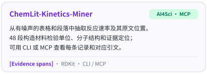</picture></a>&nbsp;
  <a href="https://github.com/WenNinghan/shiye"><picture><source media="(prefers-color-scheme: dark)" srcset="./assets/profile/cards/shiye-dark.svg">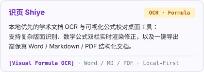</picture></a>

  <a href="https://github.com/WenNinghan/local-chat-insights"><picture><source media="(prefers-color-scheme: dark)" srcset="./assets/profile/cards/chatinsights-dark.svg">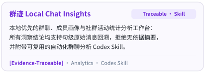</picture></a>&nbsp;
  <a href="https://github.com/WenNinghan/Toccata-Windows"><picture><source media="(prefers-color-scheme: dark)" srcset="./assets/profile/cards/toccata-dark.svg">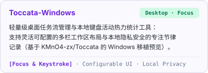</picture></a>

### 🐾 Play & Create · 桌面宠物小舞台与互动创意

<table>
  <tr>
    <td width="36%" align="center" valign="middle">
       
      
      &nbsp;&nbsp;&nbsp;&nbsp;
      
        
      <a href="https://github.com/WenNinghan/yuexinmiao-codex-pet"><b>月薪喵 · Waving</b></a> &nbsp;｜&nbsp; <a href="https://github.com/WenNinghan/daimaobatiao-codex-pet"><b>呆猫八条 · Jumping</b></a>
        
    </td>
    <td width="64%" valign="middle">
      ✨ <b><a href="https://github.com/WenNinghan/yuexinmiao-codex-pet">月薪喵 (Yuexinmiao)</a></b> · 陪伴写代码的 Codex 桌面宠物，内置挥手、小憩等多状态帧动画、安装包与完整制作资料。  
      🐾 <b><a href="https://github.com/WenNinghan/daimaobatiao-codex-pet">呆猫八条 (Daimaobatiao)</a></b> · 灰白手绘贴纸风格的 Codex 桌面宠物，轻巧呆萌，支持桌面互动跳跃。  
      🍔 <b><a href="https://github.com/WenNinghan/mcmultiverse">麦门宇宙 (McMultiverse)</a></b> · 基于真实菜单与报价查询的零依赖互动创意作品，串联盲选、猜价与 A/B 趣味取舍。
    </td>
  </tr>
</table>

<b>📚 HUST AIAADC · 华中科大人工智能与自动化学院开源课程共建（点击展开 24 门核心课程与资料导航）</b>

 

参与建设学院的课程资料与学习资源，把课件、笔记、复习经验和同学作品整理成更容易找到的入口。

**按年级查找：** [大一资源](https://github.com/AIAADC/Resources-for-freshman-in-AIA) · [大二资源](https://github.com/AIAADC/Resources-for-sophomore-in-AIA) · [大三资源](https://github.com/AIAADC/Resources-for-junior-in-AIA) · [资源导航平台](https://github.com/AIAADC/aiaadc-resource-site)

| 方向 | 课程资料 |
| --- | --- |
| **数学与基础科学** | [微积分](https://github.com/AIAADC/wjf) · [线性代数](https://github.com/AIAADC/linear-algebra) · [概率论与数理统计](https://github.com/AIAADC/Probability-and-Statistics) · [大学物理](https://github.com/AIAADC/Physics) · [离散数学](https://github.com/AIAADC/Discrete-Mathematics) · [复变函数与积分变换](https://github.com/AIAADC/AIAADC-Complex-Functions-and-Integral-Transforms) · [数值计算方法](https://github.com/AIAADC/Numerical-Methods) |
| **计算机与人工智能** | [C 语言](https://github.com/AIAADC/C-Programming-Language) · [数据结构](https://github.com/AIAADC/Data-Structure) · [计算机网络](https://github.com/AIAADC/Computer-Networks) · [数据科学基础](https://github.com/AIAADC/Foundation-of-data-science) · [人工智能导论](https://github.com/AIAADC/Introduction-to-Artificial-Intelligence) · [模式识别与机器学习](https://github.com/AIAADC/Pattern-Recognition-and-Machine-Learning) |
| **电子与信号** | [电路理论](https://github.com/AIAADC/Circuit-Theory) · [模拟电子技术](https://github.com/AIAADC/Analog-Electronics-Technology) · [数字电路](https://github.com/AIAADC/Digital-circuit) · [信号与系统](https://github.com/AIAADC/Introduction-to-Signals-and-Systems) |
| **控制与系统** | [自动控制原理（一）](https://github.com/AIAADC/Principles-of-Automatic-Control) · [自动控制原理（二）](https://github.com/AIAADC/Principles-of-Automatic-Control-) · [电机拖动基础](https://github.com/AIAADC/Fundamentals-of-Electric-Machines-and-Drives) · [传感技术](https://github.com/AIAADC/Sensor-Principles-and-Applications) · [微机原理](https://github.com/AIAADC/Principles-of-Microcomputers) |

**一起分享：** [笔记共享](https://github.com/AIAADC/Note-Sharing) · [期中分享会](https://github.com/AIAADC/Midterm-Presentation) · [期末分享会](https://github.com/AIAADC/Final-Exam-Presentation) · [同学项目](https://github.com/AIAADC/student-projects) · [组织介绍](https://github.com/AIAADC/.github)

课程资料由老师、学长学姐和同学共同积累，各仓库保留相应来源与署名。 · <a href="https://github.com/WenNinghan/WenNinghan">个人主页源文件</a>

---

  欢迎交流 <b>AI4SCI、复杂网络、科研工具与开源学习</b> ✨ &nbsp;·&nbsp; <a href="https://winniehoney.win/">winniehoney.win</a>

