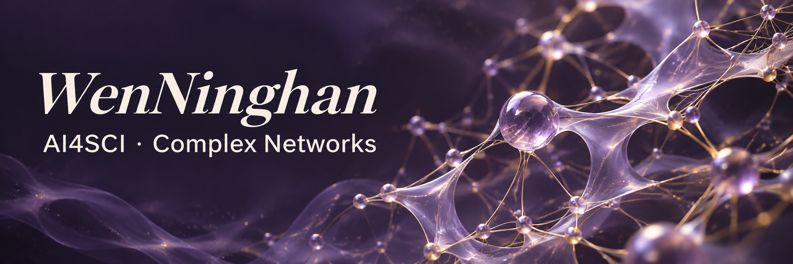

<strong>华中科技大学 · 人工智能与自动化学院本科生</strong> 
关注 AI4SCI 与复杂网络，围绕环境反应动力学建模、复杂系统与多目标优化开展研究。

<a href="https://winniehoney.win/">个人网站 · WinnieHoney</a> &nbsp; · &nbsp;
<a href="https://github.com/WenNinghan?tab=repositories">全部仓库</a> &nbsp; · &nbsp;
<a href="https://github.com/AIAADC">AIAADC</a>

## Research & learning · 研究与学习

| 项目 | 内容 |
| --- | --- |
| **[DECAT](https://github.com/WenNinghan/DECAT)** | 化学感知双专家模型，预测臭氧–污染物反应速率；提供代码、数据与在线推理。 |
| **[HEOA](https://github.com/WenNinghan/HEOA)** | 人类进化优化算法的论文阅读与复现，包含三杆桁架约束优化、收敛与可行性分析。 |
| **[复杂网络](https://github.com/WenNinghan/ComplexNetworks)** | 复杂网络理论、算法与学习资料；Fork 自 [XL-lab-bigdata/ComplexNetworks](https://github.com/XL-lab-bigdata/ComplexNetworks)。 |
| **[深度学习实践](https://github.com/WenNinghan/Deep-Learing)** | 基于《深度学习入门》的章节代码学习与实验，包含优化器对比和训练可视化。 |

## Tools · 学习与效率工具

| 项目 | 内容 |
| --- | --- |
| **[识页 Shiye](https://github.com/WenNinghan/shiye)** | 本地 OCR、可视化公式校对与 Word / Markdown / PDF 导出；Windows 预发布版。 |
| **[Toccata-Windows](https://github.com/WenNinghan/Toccata-Windows)** | 任务管理与本地键盘活动统计；[KMnO4-zx 的 macOS 原作](https://github.com/KMnO4-zx/Toccata)的非官方 Windows 移植。 |

## Play & create · 一些有趣的作品

- **[麦门宇宙](https://github.com/WenNinghan/mcmultiverse)** · 基于真实菜单与报价查询的非官方互动创意作品，串联盲选、猜价与 A/B 取舍。
- **[月薪喵](https://github.com/WenNinghan/yuexinmiao-codex-pet)** · Codex 桌面宠物，包含动画、安装包、预览与制作资料。
- **[呆猫八条](https://github.com/WenNinghan/daimaobatiao-codex-pet)** · 灰白贴纸风格的 Codex 桌面宠物，包含动画、安装包与制作资料。

&nbsp; &nbsp; &nbsp;

## AIAADC · 开源共建

参与建设学院的课程资料与学习资源，把课件、笔记、复习经验和同学作品整理成更容易找到的入口。

**按年级查找：** [大一资源](https://github.com/AIAADC/Resources-for-freshman-in-AIA) · [大二资源](https://github.com/AIAADC/Resources-for-sophomore-in-AIA) · [大三资源](https://github.com/AIAADC/Resources-for-junior-in-AIA) · [资源导航平台](https://github.com/AIAADC/aiaadc-resource-site)

| 方向 | 课程资料 |
| --- | --- |
| **数学与基础科学** | [微积分](https://github.com/AIAADC/wjf) · [线性代数](https://github.com/AIAADC/linear-algebra) · [概率论与数理统计](https://github.com/AIAADC/Probability-and-Statistics) · [大学物理](https://github.com/AIAADC/Physics) · [离散数学](https://github.com/AIAADC/Discrete-Mathematics) · [复变函数与积分变换](https://github.com/AIAADC/AIAADC-Complex-Functions-and-Integral-Transforms) · [数值计算方法](https://github.com/AIAADC/Numerical-Methods) |
| **计算机与人工智能** | [C 语言](https://github.com/AIAADC/C-Programming-Language) · [数据结构](https://github.com/AIAADC/Data-Structure) · [计算机网络](https://github.com/AIAADC/Computer-Networks) · [数据科学基础](https://github.com/AIAADC/Foundation-of-data-science) · [人工智能导论](https://github.com/AIAADC/Introduction-to-Artificial-Intelligence) · [模式识别与机器学习](https://github.com/AIAADC/Pattern-Recognition-and-Machine-Learning) |
| **电子与信号** | [电路理论](https://github.com/AIAADC/Circuit-Theory) · [模拟电子技术](https://github.com/AIAADC/Analog-Electronics-Technology) · [数字电路](https://github.com/AIAADC/Digital-circuit) · [信号与系统](https://github.com/AIAADC/Introduction-to-Signals-and-Systems) |
| **控制与系统** | [自动控制原理（一）](https://github.com/AIAADC/Principles-of-Automatic-Control) · [自动控制原理（二）](https://github.com/AIAADC/Principles-of-Automatic-Control-) · [电机拖动基础](https://github.com/AIAADC/Fundamentals-of-Electric-Machines-and-Drives) · [传感技术](https://github.com/AIAADC/Sensor-Principles-and-Applications) · [微机原理](https://github.com/AIAADC/Principles-of-Microcomputers) |

**一起分享：** [笔记共享](https://github.com/AIAADC/Note-Sharing) · [期中分享会](https://github.com/AIAADC/Midterm-Presentation) · [期末分享会](https://github.com/AIAADC/Final-Exam-Presentation) · [同学项目](https://github.com/AIAADC/student-projects) · [组织介绍](https://github.com/AIAADC/.github)

课程资料由老师、学长学姐和同学共同积累，各仓库保留相应来源与署名。

其他仓库 · 阶段任务与主页源文件

- [HRT 阶段任务入口](https://github.com/WenNinghan/HRT_-)：当前为空仓库。
- [个人主页源文件](https://github.com/WenNinghan/WenNinghan)：本页 README 与视觉素材。

---

欢迎交流 **AI4SCI、复杂网络、科研工具与开源学习**。 &nbsp; [winniehoney.win](https://winniehoney.win/)
