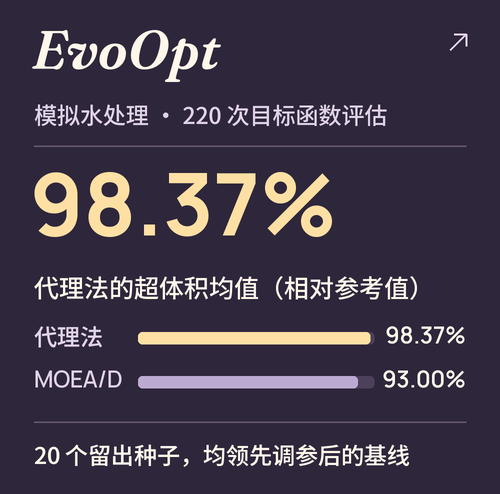
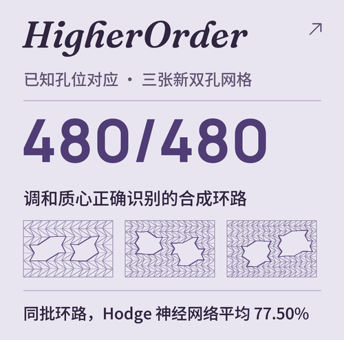
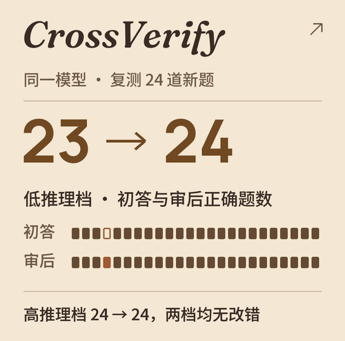

  

  华中科技大学自动化本科生，研究水处理动力学、多目标优化与复杂网络。 
  <a href="https://winniehoney.win/">个人网站 ↗</a>　·　<a href="https://github.com/WenNinghan?tab=repositories">公开仓库</a>　·　<a href="https://github.com/AIAADC">HUST AIAADC</a>

## 代表实验

  <a href="https://github.com/WenNinghan/EvoOpt-Surrogate-Bench#held-out-small-budget-comparison"><picture><source media="(max-width: 767px)" srcset="./assets/profile/featured/evoopt-mobile.png"></picture></a>
  <a href="https://github.com/WenNinghan/HigherOrder-Simplicial-Lab#frozen-transfer-to-three-unseen-meshes"><picture><source media="(max-width: 767px)" srcset="./assets/profile/featured/higherorder-mobile.png"></picture></a>
  <a href="https://github.com/WenNinghan/CrossVerify-Bench#single-model-review-on-24-new-questions"><picture><source media="(max-width: 767px)" srcset="./assets/profile/featured/crossverify-mobile.png"></picture></a>

查看实验条件与原始数据

- **EvoOpt** 挑战的是预算很小时基线是否仍有竞争力。用 8 个种子调参，再用另外 20 个种子测试。代理法在模拟水处理中比调参后的 MOEA/D 平均高 5.37 个参考超体积百分点，配对 95% 区间为 4.32–6.44。[逐种子结果与可行解](https://github.com/WenNinghan/EvoOpt-Surrogate-Bench/blob/main/results/small_budget_tuning.json)
- **HigherOrder** 的四类合成环路按绕孔方向区分，调和坐标使用两个已知孔位对齐。三张新网格共 480 条环路，三个训练种子使用同一套目标样本。[逐网格分类与缺边补全结果](https://github.com/WenNinghan/HigherOrder-Simplicial-Lab/blob/main/results/mesh_transfer.json)
- **CrossVerify** 的五家族旧题回放中，审稿既有改对也有改错。换同一模型做 24 道新题时，低推理档只修对一道变步长约瑟夫问题，高档初答已经全对。[低档逐题记录](https://github.com/WenNinghan/CrossVerify-Bench/blob/main/results/fresh_holdout/paired_results.json) · [高档逐题记录](https://github.com/WenNinghan/CrossVerify-Bench/blob/main/results/fresh_holdout/higher_effort/paired_results.json)

## 论文与研究代码

**水处理反应动力学数据库**　我参与的这项 *Scientific Data* 工作整理了 8 类氧化剂或自由基与污染物反应的 11,579 条二级速率常数记录。[论文](https://www.nature.com/articles/s41597-026-08320-x) · [开放数据](https://doi.org/10.6084/m9.figshare.31725223.v2)

**DECAT**　我作为共同第一作者参与的臭氧反应动力学研究，用分子结构与实验条件预测反应速率。仓库提供模型权重、预测代码与适用域分析。[项目与代码](https://github.com/WenNinghan/DECAT)

## 开源项目

**算法与学习**　[NetControl](https://github.com/WenNinghan/NetControl-Pinning-Lab) 网络牵制控制 · [HEOA](https://github.com/WenNinghan/HEOA) 约束优化复现 · [Deep-Learning](https://github.com/WenNinghan/Deep-Learning) 从零实现神经网络。教材配套的 [ComplexNetworks](https://github.com/WenNinghan/ComplexNetworks) 保留[原作者仓库](https://github.com/XL-lab-bigdata/ComplexNetworks)及署名。

**研究工具**　[ChemLit](https://github.com/WenNinghan/ChemLit-Kinetics-Miner) 按原文定位动力学记录 · [OmniHarness](https://github.com/WenNinghan/OmniHarness) 多智能体协作 · [识页](https://github.com/WenNinghan/shiye) 本地 OCR 与公式校对 · [群迹](https://github.com/WenNinghan/local-chat-insights) 本地聊天记录分析。

**桌面与创意**　[Toccata-Windows](https://github.com/WenNinghan/Toccata-Windows) 是基于 [KMnO4-zx/Toccata](https://github.com/KMnO4-zx/Toccata) 的 Windows 移植预览。[麦门宇宙](https://github.com/WenNinghan/mcmultiverse) 是一款网页小游戏。[月薪喵](https://github.com/WenNinghan/yuexinmiao-codex-pet) 和 [呆猫八条](https://github.com/WenNinghan/daimaobatiao-codex-pet) 是两只 Codex 桌面宠物。

<b>HUST AIAADC · 华中科技大学人工智能与自动化学院课程共建</b>

课件、笔记和复习经验由老师、学长学姐和同学共同积累，各仓库保留资料来源与署名。

- **按年级直达**　大一资源](https://github.com/AIAADC/Resources-for-freshman-in-AIA) · [大二资源](https://github.com/AIAADC/Resources-for-sophomore-in-AIA) · [大三资源](https://github.com/AIAADC/Resources-for-junior-in-AIA) · [资源导航平台](https://github.com/AIAADC/aiaadc-resource-site)
- **数学与基础科学**　微积分](https://github.com/AIAADC/wjf) · [线性代数](https://github.com/AIAADC/linear-algebra) · [概率论与数理统计](https://github.com/AIAADC/Probability-and-Statistics) · [大学物理](https://github.com/AIAADC/Physics) · [离散数学](https://github.com/AIAADC/Discrete-Mathematics) · [复变函数与积分变换](https://github.com/AIAADC/AIAADC-Complex-Functions-and-Integral-Transforms) · [数值计算方法](https://github.com/AIAADC/Numerical-Methods)
- **计算机与人工智能**　 [C 语言](https://github.com/AIAADC/C-Programming-Language) · [数据结构](https://github.com/AIAADC/Data-Structure) · [计算机网络](https://github.com/AIAADC/Computer-Networks) · [数据科学基础](https://github.com/AIAADC/Foundation-of-data-science) · [人工智能导论](https://github.com/AIAADC/Introduction-to-Artificial-Intelligence) · [模式识别与机器学习](https://github.com/AIAADC/Pattern-Recognition-and-Machine-Learning)
- **电子与信号**　电路理论](https://github.com/AIAADC/Circuit-Theory) · [模拟电子技术](https://github.com/AIAADC/Analog-Electronics-Technology) · [数字电路](https://github.com/AIAADC/Digital-circuit) · [信号与系统](https://github.com/AIAADC/Introduction-to-Signals-and-Systems)
- **控制与系统**　自动控制原理（一）](https://github.com/AIAADC/Principles-of-Automatic-Control) · [自动控制原理（二）](https://github.com/AIAADC/Principles-of-Automatic-Control-) · [电机拖动基础](https://github.com/AIAADC/Fundamentals-of-Electric-Machines-and-Drives) · [传感技术](https://github.com/AIAADC/Sensor-Principles-and-Applications) · [微机原理](https://github.com/AIAADC/Principles-of-Microcomputers)
- **一起分享**　笔记共享](https://github.com/AIAADC/Note-Sharing) · [期中分享会](https://github.com/AIAADC/Midterm-Presentation) · [期末分享会](https://github.com/AIAADC/Final-Exam-Presentation) · [同学项目](https://github.com/AIAADC/student-projects) · [组织介绍](https://github.com/AIAADC/.github)

[个人网站](https://winniehoney.win/) · [主页源文件](https://github.com/WenNinghan/WenNinghan)
